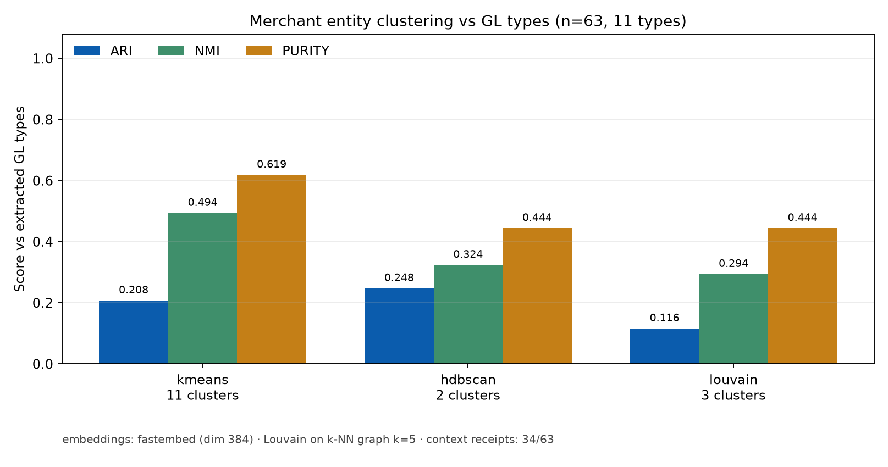
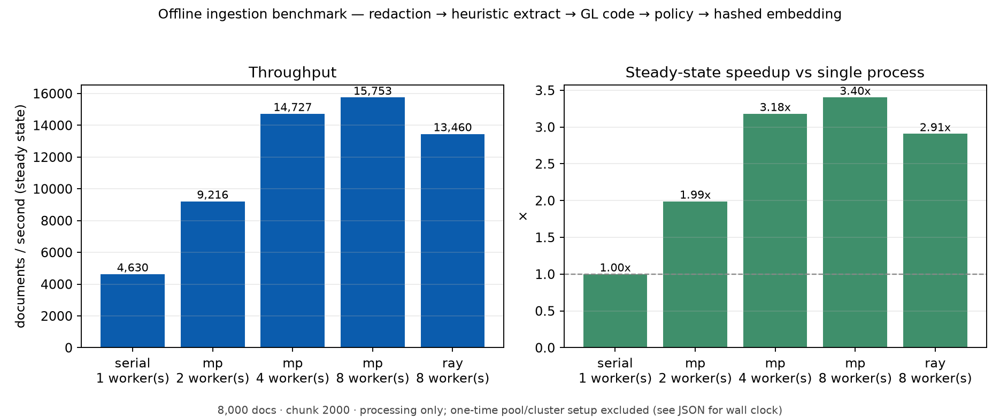

# ExpenseIQ

**An AI expense-workflow engine.** It ingests receipts and card transactions, extracts
structured fields, codes each item to a GL account, checks it against company policy, and
routes approvals to the right human. Every AI step is **versioned, evaluated, traced, and
self-correcting** — so quality is a number, not a vibe.

<p align="center">
  
  
  
  
</p>

---

## Table of contents

- [What it does](#what-it-does)
- [Objectives](#objectives)
- [Architecture](#architecture)
- [Stack & the gap each piece closes](#stack--the-gap-each-piece-closes)
- [Repository layout](#repository-layout)
- [Quickstart](#quickstart)
- [Build order / roadmap](#build-order--roadmap)
- [Measuring quality](#measuring-quality)
- [Safety, confidence and drift](#safety-confidence-and-drift)
- [Graph layer (Neo4j + GraphQL)](#graph-layer-neo4j--graphql)
- [Merchant clustering](#merchant-clustering)
- [Distributed ingestion benchmark](#distributed-ingestion-benchmark)
- [Cross-runtime export & CPU benchmark](#cross-runtime-export--cpu-benchmark)
- [Instruction fine-tuning (SFT) — free Colab T4](#instruction-fine-tuning-sft--free-colab-t4)
- [CI/CD: Airflow, GitLab, Jenkins](#cicd-airflow-gitlab-jenkins)
- [Review UI & accessibility](#review-ui--accessibility)
- [Evidence](#evidence)
- [Security practices](#security-practices)

---

## What it does

Upload a receipt image (or push a card transaction) and ExpenseIQ:

1. **Redacts** PII / card numbers *before* anything leaves the box.
2. **Extracts** structured fields from the receipt with an LLM using schema-guided JSON.
3. **Repairs** invalid or low-confidence output automatically (retry with error feedback →
   fallback model → human-review queue).
4. **Codes** the item to a GL category using merchant/policy retrieval (hybrid BM25 + vector).
5. **Checks** policy (per-item limits, allowed categories, missing receipts) and **routes**
   for approval.
6. **Records** every model + prompt version, its accuracy, p95 latency and cost-per-document.
7. **Learns**: user corrections flow back into the golden eval set; CI blocks any prompt
   change that regresses accuracy.

## Objectives

| # | Objective | How it's met |
|---|-----------|--------------|
| 1 | **Production service** | Node.js (TypeScript) backend for submissions, approvals, webhooks, calling a Python FastAPI AI service |
| 2 | **Measured quality** | Receipt field accuracy, coding accuracy, p95 latency, cost/document tracked **per prompt and model version** |
| 3 | **Reliability** | Failed/invalid outputs repair themselves; only leftovers reach a human queue |
| 4 | **Continuous improvement** | User corrections feed the eval set; CI gate blocks prompt regressions |

## Architecture

```
                        ┌──────────────── LOCAL (Docker Desktop) ────────────────┐
   receipts / txns      │                                                        │
        │               │   ┌───────────────────┐        ┌────────────────────┐  │
        ▼               │   │  backend          │  HTTP  │  ai-service        │  │
   ┌─────────┐  POST    │   │  Node.js + TS     │ ─────▶ │  Python + FastAPI  │  │
   │ client  │ ───────▶ │   │  Fastify          │        │  · redaction       │  │
   └─────────┘          │   │  submissions /    │ ◀───── │  · extraction      │  │
        ▲   approvals   │   │  approvals /      │  JSON  │  · GL coding       │  │
        │   webhooks    │   │  webhooks         │        │  · policy check    │  │
        │               │   └────────┬──────────┘        └─────────┬──────────┘  │
        │               │            │                             │             │
        │               │   ┌────────▼─────────────────────────────▼──────────┐  │
        │               │   │ Postgres · MongoDB · OpenSearch (hybrid search) │  │
        │               │   └────────┬────────────────────────────────────────┘  │
        │               │            │  traces                                   │
        │               │   ┌────────▼─────────┐   ┌───────────────────────────┐ │
        └───────────────┼───│ Langfuse         │   │ W&B (evals, artifacts)    │ │
                        │   └──────────────────┘   └───────────────────────────┘ │
                        └─────────────────────────────┬──────────────────────────┘
                                                      │ OpenAI-compatible API
                                        ┌─────────────▼───────────────┐
                                        │ RENTED GPU (vLLM, on-demand)│
                                        │  Qwen2.5-Instruct · guided  │
                                        │  JSON · QLoRA + vLLM        │
                                        └─────────────────────────────┘
```

The model is **self-hosted** (vLLM on a rented GPU), not a paid API — so the platform
records a real **cost-per-document** derived from GPU `$/hr ÷ docs/hr`.

## Stack & the gap each piece closes

| Component | Stack | Gap closed |
|---|---|---|
| Backend | Node.js (TypeScript), Fastify, FastAPI | Node.js + Python in production |
| Experimentation | Jupyter notebooks for dataset exploration & baselines | Jupyter |
| Experiment tracking | Weights & Biases: models/prompts/retrieval compared on accuracy, latency, cost | W&B, evals, cost tracking |
| Prompt lifecycle | Prompt registry (draft → eval → prod → rollback) per use case; PromptFoo regression suite as CI gate | Prompt version control, PromptFoo |
| Self-healing harness | Schema validation, retry with error feedback, fallback model, human-review queue | Agent loops, self-healing |
| Extraction & coding | LLM structured outputs for receipts (SROIE/CORD); transaction classification; optional QLoRA served with vLLM | Document intelligence, classification, fine-tuning & serving |
| Instruction tuning (SFT) | `trl.SFTTrainer` + PEFT QLoRA on Qwen2.5-1.5B with public Dolly + synthetic GL corpus; free Colab T4 | Instruction fine-tuning & domain adaptation |
| Databases | PostgreSQL (transactions), MongoDB (raw extractions, traces), OpenSearch hybrid BM25 + vector (policies, merchants) | Postgres, MongoDB, vector search |
| Observability & feedback | Langfuse traces; correction endpoint feeding the golden set | Observability, production feedback loop |
| Safeguards | PII + card-number redaction before every LLM call (reuses the **Fortress** middleware) | Sensitive financial data |
| Warehouse | Snowflake for spend analytics, queried by the "ask about my spend" assistant | Data warehouse |
| Assistant | Copilot-style agent patterns over the warehouse | Intelligent assistants |
| Graph API | Neo4j 5 + Strawberry GraphQL at `/graphql` | Entity graph + traversals over expenses, merchants, policies |
| Merchant clustering | scikit-learn (k-means/HDBSCAN), NetworkX (Louvain), fastembed | Unsupervised merchant segments vs GL codes |
| Distributed benchmark | Ray cluster (Docker) + stdlib multiprocessing | Measured parallel ingestion |
| Review UI | Streamlit + axe-core + Lighthouse | Human review + accessibility evidence |

## Repository layout

```
expenseiq/
├── backend/            Node.js (TypeScript) service — submissions/approvals/webhooks
├── ai-service/         Python FastAPI AI service (extraction, coding, policy, graph)
│   └── app/            routers, schemas, graph (Neo4j/GraphQL/clustering), llm, redaction
├── ui/                 Streamlit review console (queue, clusters, graph details)
├── a11y/               Playwright + axe-core + Lighthouse audit harness
├── scripts/            Graph build/cluster/probe + serial/mp/Ray ingestion benchmark
├── notebooks/          Jupyter: dataset exploration + baseline evals (headless-executed)
├── prompt-registry/    Versioned prompts (draft/eval/prod) per use case
├── evals/              Golden eval set + PromptFoo regression suite
├── harness/            Self-healing loop (validate → retry → fallback → human queue)
├── infra/              docker-compose: Postgres, MongoDB, OpenSearch, Neo4j, Langfuse, Ray
├── warehouse/          Snowflake DDL + queries for spend analytics
├── gpu/                Runbook + endpoint checker for the self-hosted vLLM
├── sft/                Free-Colab TRL/QloRA instruction tuning + synthetic GL corpus
├── runtime/            ONNX/TFLite export, parity and CPU benchmark harness
├── airflow/            Offline ingestion → eval → gate DAG + local runbook
├── tests/              Airflow wiring + CI config lint + runtime parity tests
├── evidence/           Screenshots + logs (SCREENSHOTS.md manifest)
├── .github/workflows/  CI: lint, tests, PromptFoo regression gate
├── .gitlab-ci.yml      GitLab mirror: lint, pytest, eval gate, benchmark smoke
└── Jenkinsfile         Smoke stage: install, lint, pytest subset
```

## Quickstart

```bash
cp .env.example .env          # fill in W&B + GPU endpoint + Snowflake

# 1) datastores + observability
cd infra && docker compose up -d && cd ..

# 2) python env + AI service
cd ai-service && uv sync && uv run uvicorn app.main:app --reload --port 8080

# 2b) seed OpenSearch hybrid indices (merchants + policies)
cd ai-service && uv sync --extra search && uv run python scripts/index_opensearch.py

# 2c) Node backend (approvals, webhooks)
cd backend && npm install && npm run dev

# 2d) entity graph + merchant clusters (Neo4j is part of infra-up)
cd ai-service && uv sync --dev --extra search
cd ai-service && uv run python scripts/build_graph.py --reset --export ../runs/graph_export.json
cd ai-service && uv run python scripts/cluster_graph.py --write-neo4j
cd ai-service && uv run python scripts/graphql_probe.py --iterations 25

# 2e) Streamlit review console
make ui-install && make ui-run          # http://localhost:8501

# 2f) Ray cluster + canonical ingestion benchmark
make ray-up && make bench-ray

# 3) GPU: follow gpu/RUNBOOK.md, then verify
python gpu/check_gpu.py
```

## Build order / roadmap

1. **Notebooks, dataset, baseline evals in W&B**
2. **FastAPI AI service, prompt registry, PromptFoo gate**
3. **Node.js backend with Postgres, MongoDB, OpenSearch hybrid retrieval, approvals + webhooks**
4. **Self-healing harness, Langfuse, feedback loop**
5. **Snowflake warehouse + spend assistant** (guarded NL→SQL over the views)
6. **QLoRA GL-coding classifier** fine-tuned and served — plus a four-way comparison (base/tuned 0.5B vs prompted 7B ± retrieval) on an **unseen-merchant** split
7. **Graph + clustering + distributed ingestion + accessible review UI** — Neo4j/GraphQL, k-means/HDBSCAN/Louvain, Ray vs multiprocessing, axe/Lighthouse before/after

## Measuring quality

| Metric | Definition | Where tracked |
|---|---|---|
| Field accuracy | per-field exact/soft match vs golden set (merchant, date, total, tax, currency) | W&B |
| Coding accuracy | predicted GL == expected GL | W&B |
| p95 latency | end-to-end per document | W&B + Langfuse |
| Cost / document | GPU `$/hr ÷ docs/hr` (self-hosted) | W&B |
| Self-heal rate | % repaired without human | Langfuse + harness logs |
| Human-queue rate | % escalated | harness logs |
| Graph latency | p50/p95 per GraphQL query | `runs/graphql_probe.json` |
| Cluster agreement | ARI / NMI / purity vs GL codes | `runs/graph_clusters.json` |
| Ingest throughput | docs/s, speedup, efficiency | `runs/ingest_benchmark.json` |
| Accessibility | axe violations + Lighthouse score | `runs/a11y_scores.json` |

## Safety, confidence and drift

**Purpose and scope.** ExpenseIQ extracts receipt fields and recommends a route for internal
finance workflows. It is decision support, not an autonomous payment, tax, credit,
employment or audit decision system, and it is not approved for documents outside the
supported receipt/invoice formats.

**Human oversight.** A document is auto-approved only when the schema validates, every
required field clears its calibrated threshold, and the calibrated document score reaches
`0.75`. Missing required fields fail closed to `reject_escalate`; anything between the
reject and auto thresholds goes to `human_review`. Reviewers see per-field confidence,
record approve/correct/reject decisions in an append-only audit trail, and corrections are
stored as labelled data. A kill switch (`POST /admin/kill-switch`) forces every new document
to human review without redeploying.

### Measured calibration and routing

Golden set `v0` (75 documents: 50 SROIE + 25 CORD), replaying cached Qwen2.5-7B predictions
on CPU. No live model calls and no paid APIs were used.

| Metric | Before | After |
|---|---|---|
| Document ECE (lower is better) | 0.1493 | **0.0368** (−75.4%) |
| Merchant ECE | 0.0332 | **0.0232** (−30.0%) |
| Total-amount ECE | 0.0183 | **0.0142** (−22.1%) |
| Transaction-date ECE | 0.1070 | **0.0533** (−50.2%) |
| Auto-approved documents | — | 33/75 (44.0%) |
| Accuracy on auto-approved documents | — | 96.97% macro field, 90.91% exact document |
| Routed to review / reject | — | 21.3% / 34.7% |
| Errors reaching a human (review + reject) | — | 35/38 (92.1%) |
| Errors auto-approved | — | 3/38 |
| Confidence scoring + routing latency (p95) | — | 0.10 ms per document |

Isotonic calibration is cross-fitted over five document folds, then fitted on all 75
documents for serving. The operating point uses a 0.95 accuracy floor; 0.75 was selected
from the measured sweep. Route thresholds, signal weights and calibration curves live in
[`ai-service/config/confidence.yaml`](ai-service/config/confidence.yaml) and
[`ai-service/config/calibration.json`](ai-service/config/calibration.json).

### Drift monitoring

PSI on log amount, PSI on transaction quarter, two-sample KS on amount and date, PSI on
merchant category, and bge-small embedding-centroid distance run over 50-document windows
against a prediction-aligned baseline (the cached model outputs, not golden labels).
On the synthetic replay (30 fastembed replicates, 150 null windows; thresholds calibrated at
the 99.5th percentile of null windows):

| Scenario | Detection rate | Null false alarms | Time to detect |
|---|---|---|---|
| New merchants | 100% | 0/30 | 25 documents |
| New receipt format | 100% | 0/30 | 25 documents |
| Noisy OCR | 100% | 0/30 | 25 documents |
| Amount shift | 100% | 0/30 | 25 documents |
| Date shift | 100% | 0/30 | 25 documents |

Detector-only latency is 2.3 ms p50; embedding 50 documents with bge-small on CPU takes
6.5 s in a background task. Prometheus metrics, Grafana panels and alert rules are in
[`infra/observability/`](infra/observability/). The CI gate refuses merges when ECE,
auto-approval accuracy, human catch rate, false alarms or shift detection regress.

### Known limitations

- The golden set has 75 public receipts; confidence intervals are wide and the mix is not
  production traffic. SROIE/CORD over-represent Malaysian and English receipts.
- The cached LLM outputs expose self-reported confidence, not token logprobs, so the
  logprob signal is disabled; calibration cannot fix a systematically overconfident model.
- The router is deliberately conservative: 34.7% of documents are rejected, creating
  manual work. Three of 38 measured errors still reached auto-approval.
- Drift scenarios are synthetic; embedding distance is slower on CPU and has only been
  validated on this corpus. There is no live production baseline yet.
- Handwriting, heavy blur, non-receipt images and adversarial text are out of scope.

**Privacy and data handling.** Card numbers and PII are redacted before model calls;
review text is stored in the internal Postgres/MongoDB deployment; corrections are retained
for evaluation and can be exported for deletion requests. Secrets stay in `.env`.

**Ownership and escalation.** The ML platform team owns calibration and drift; the finance
operations lead owns queue SLAs and reviewer staffing. Pages go to on-call for
`DriftDetected`; tickets go to the ML platform queue for calibration or backlog regressions.
See [`docs/runbooks/drift.md`](docs/runbooks/drift.md),
[`docs/runbooks/hitl.md`](docs/runbooks/hitl.md) and the
[final measured report](docs/FINAL_REPORT.md).

**Prohibited use.** Do not use the system to make final payment, tax, credit, employment or
audit decisions without a qualified human; do not feed secrets, credentials or documents
outside the approved data classification.

## Graph layer (Neo4j + GraphQL)

`ai-service` serves a Strawberry GraphQL schema at `POST /graphql` over Neo4j 5
(`infra/docker-compose.yml`, `eq-neo4j`). The graph is rebuilt deterministically from the
same golden set and merchant catalog used by the evals.

| Query | Use |
|---|---|
| `graphStats` | entity/relationship counts, cluster count |
| `entities(type, limit, offset)` | paginated expense/merchant/category lists |
| `entity(id)` | single node with properties |
| `neighbors(id, depth, relType)` | 1–3 hop traversal (policy, route, merchant, date) |
| `searchEntities(q)` | case-insensitive label search |
| `clusters(algorithm)` | persisted k-means / HDBSCAN / Louvain results |

Shape after `make graph-build`: **175 entities / 462 relationships** — 75 Expense,
63 Merchant, 13 Category, 8 Policy, 11 Date, 2 Source, 3 Route; 4 `VIOLATES` edges.
Writing clusters adds 16 `:Cluster` nodes and 186 `IN_COMMUNITY` edges (648 relationships
visible through GraphQL; `entities` counts only `:Entity` nodes).

| Query | p50 | p95 |
|---|---:|---:|
| `graphStats` | 11.4 ms | 24.2 ms |
| `entity` | 4.1 ms | 7.3 ms |
| `neighbors` | 7.3 ms | 9.1 ms |
| `searchEntities` | 4.5 ms | 5.5 ms |
| `clusters` | 6.1 ms | 7.5 ms |

25 iterations each, local Docker, HTTP. Raw data: [`runs/graphql_probe.json`](runs/graphql_probe.json).

## Merchant clustering

63 merchants, 11 observed GL categories, 384-d fastembed vectors
(`BAAI/bge-small-en-v1.5`), 34 merchants enriched with receipt context. Labels are the
extracted GL category; the question is whether merchant semantics recover that taxonomy
without supervision.

| Algorithm | Clusters | Noise | ARI | NMI | Purity | Modularity |
|---|---:|---:|---:|---:|---:|---:|
| k-means (k=11) | 11 | 0 | 0.208 | 0.494 | **0.619** | — |
| HDBSCAN | 2 | 0 | **0.248** | 0.324 | 0.444 | — |
| Louvain (kNN k=5) | 3 | 0 | 0.116 | 0.294 | 0.444 | **0.509** |

Purity is the share of the dominant GL code in a cluster; ARI/NMI compare cluster
assignments to those codes. The taxonomy is coarse and overlapping (e.g. Amazon can be
office supplies or hardware), so purity ~0.62 is the realistic ceiling for this label set.



## Distributed ingestion benchmark

Offline path only: redaction → heuristic extraction → GL coding → policy → 384-d hashed
embedding. 8,000 documents, chunk size 2,000, **8 CPUs** (Ray head + two 4-CPU workers),
10-core host. Throughput excludes one-time pool/cluster setup; wall clock is in the JSON.

| Backend | Workers | docs/s | Speedup | Efficiency | p50 / p95 |
|---|---:|---:|---:|---:|---:|
| serial | 1 | 4,630 | 1.00× | 1.00 | 0.224 / 0.399 ms |
| multiprocessing | 2 | 9,216 | 1.99× | 0.995 | 0.222 / 0.390 ms |
| multiprocessing | 4 | 14,727 | 3.18× | 0.795 | 0.283 / 0.466 ms |
| multiprocessing | 8 | 15,753 | 3.40× | 0.425 | 0.271 / 0.428 ms |
| **Ray cluster** | 8 | **13,460** | **2.91×** | 0.363 | 0.303 / 0.491 ms |

All five runs produced the same output hash (`532b8f45c5a6a556`). Ray setup was 21 ms;
the cluster run is 0.62 s wall clock vs 1.73 s serial. For sub-millisecond documents,
local multiprocessing wins; Ray's value is scheduling the same unit across separate
containers and nodes, which matters once a document includes an LLM/GPU call. The figure
uses steady-state throughput; the JSON includes both wall-clock and processing-only
numbers.



Reproduce: `make ray-up && make bench-ray` (cluster) or `make bench-local` (serial + mp).

## Cross-runtime export & CPU benchmark

The smallest model already used by the service is the 33M-parameter
`BAAI/bge-small-en-v1.5` embedder (`ai-service/app/embeddings.py`). It is exported to
ONNX Runtime (fp32 + dynamic int8) and TFLite (fp32, via ONNX → TensorFlow → TFLite).
The Qwen2.5-0.5B GL-coding classifier is not the export target: no QLoRA adapter is
checked in (`gpu/finetune_qlora.py` writes to `/workspace/expenseiq-qlora`), and a 0.5B
decoder graph is too heavy for a reliable TFLite conversion. This is recorded in
`artifacts/runtime/metadata.json` under `classifier_export` and is why the embedder is
used instead.

All runtimes share one preprocessing path (`runtime/common.py`): tokenizer padding to
64 tokens, truncation, CLS pooling and L2 normalization. GL labels come from
`gpu/coding_data.py`; a fixed prototype matrix maps embeddings to the same 13 labels in
every runtime.

**Parity** (15 GL expense lines, PyTorch fp32 reference):

| Comparison | min cosine | max abs diff | label agreement | expected-label accuracy |
|---|---:|---:|---:|---:|
| ONNX Runtime fp32 | 1.000000 | 0.000000 | 15/15 | 15/15 |
| ONNX Runtime int8 (dynamic) | 0.976099 | 0.039535 | 15/15 | 15/15 |
| TFLite fp32 | 1.000000 | 0.000000 | 15/15 | 15/15 |

Pytest tolerances are explicit per runtime: ONNX fp32 requires cosine ≥ 0.99999 and
max abs diff ≤ 1e-5; TFLite requires cosine ≥ 0.999 and max abs diff ≤ 1e-4; int8
requires cosine ≥ 0.97 and max abs diff ≤ 0.06. All three also assert identical labels. TFLite float16 and dynamic-range variants were not
published because they failed on this macOS runner (`MEAN` op allocation error and NaN
outputs respectively).

**CPU benchmark** — Apple M5, 10 cores, 4 threads, batch 1, 64 tokens, 30 warm-up and
200 timed iterations. Latency excludes tokenization (pre-tokenized inputs); throughput
is single-item inference. Model size is parameter bytes for PyTorch and file size for
ONNX/TFLite; RSS is isolated per backend process.

| Backend | Precision | p50 ms | p95 ms | samples/s | Model MB | RSS after load MB | Peak RSS MB |
|---|---:|---:|---:|---:|---:|---:|---:|
| PyTorch | fp32 | 9.238 | 9.554 | 108.3 | 133.4 | 733 | 734 |
| ONNX Runtime | fp32 | **8.260** | **8.456** | **124.6** | 133.1 | 570 | 570 |
| ONNX Runtime | int8 | 8.825 | 9.337 | 115.9 | **33.8** | **438** | **438** |
| TFLite | fp32 | 9.197 | 10.453 | 107.4 | 132.3 | 808 | 809 |

ONNX Runtime fp32 is ~1.12× faster at p50 than PyTorch with ~22% lower process RSS;
int8 cuts model size by 75% and keeps 100% label agreement, though dynamic quantization
does not improve latency on this CPU. TFLite fp32 lands within 0.5% of PyTorch at p50
but has the highest runtime footprint because TensorFlow is loaded in-process. Raw runs:
[`runs/runtime_benchmark.json`](runs/runtime_benchmark.json) and
[`runs/runtime_parity.json`](runs/runtime_parity.json).

```bash
make runtime-install     # CPU venv: torch, onnx, onnxruntime, tensorflow, onnx2tf
make runtime-export      # writes artifacts/runtime/*.onnx + *.tflite (gitignored)
make runtime-bench       # benchmark + parity JSON under runs/
make runtime-test        # pytest parity/preprocessing/label-mapping tests
```

## Instruction fine-tuning (SFT) — free Colab T4

[`sft/`](sft/README.md) is a self-contained `trl.SFTTrainer` + PEFT QLoRA pipeline that
instruction-tunes **Qwen2.5-1.5B-Instruct** on Databricks Dolly plus 182 synthetic
LedgerLoop GL-coding pairs. It is distinct from `gpu/finetune_qlora.py` (classification
style, rented GPU): this one trains prompt→response instructions and runs on a free T4.

On 30 held-out transactions from unseen merchants, exact match improves from **26.7%
(base)** to **86.7% (LoRA, seed 42)**; domain completion loss falls 0.811 → **0.060** and
Dolly completion loss 2.517 → **1.544**. Across seeds 42/1/2, exact match and token F1 are
**88.9% ± 1.9 points**. Training uses 4-bit NF4, LoRA r=16, 3 epochs, effective batch 16
and 512-token sequences: 63 steps / **6m39s** on a Tesla T4, train loss **1.025**.

**What this demonstrates:** instruction fine-tuning (SFT) with `trl.SFTTrainer`, domain
adaptation to GL-coding, data preprocessing (Qwen ChatML formatting), evaluation with
loss/perplexity/token F1/exact match, and reproducible free-T4 training from pinned
versions, checked-in data and per-seed logs.

```bash
pip install -r sft/requirements.txt
python sft/format_dataset.py
python sft/train_sft.py
python sft/evaluate_sft.py --output sft/results/eval_base.json
python sft/evaluate_sft.py --adapter sft/outputs/qwen2.5-1.5b-ledgerloop-lora/final
```

Data, hyperparameters, loss curve, metrics and caveats: [`sft/README.md`](sft/README.md).
Checked-in evidence: [`sft/results/`](sft/results/).

## CI/CD: Airflow, GitLab, Jenkins

All three are offline/local by default and need no cloud credentials.

- **Airflow** — `airflow/dags/ledgerloop_pipeline.py` defines
  `ingest >> eval >> regression_gate`. It runs the serial ingestion benchmark, the
  deterministic heuristic eval (`--no-wandb`), then `evals/gate.py` against
  `evals/baseline.json`. Install the DAG environment and run it locally with
  `airflow dags test ledgerloop_offline_pipeline 2026-01-01`; full steps are in
  [`airflow/README.md`](airflow/README.md).
- **GitLab CI** — `.gitlab-ci.yml` mirrors the GitHub Actions jobs: `lint` (ruff),
  `pytest` (service + repo policy tests), `eval-gate` (heuristic eval → baseline gate)
  and `benchmark-smoke` (serial + local Ray). Use a local runner
  (`gitlab-runner exec docker <job>`) or `make ci-policy` to validate the config and DAG
  wiring without a GitLab server.
- **Jenkins** — the `Smoke` stage in `Jenkinsfile` installs `uv`, syncs `ai-service`,
  runs ruff and a fast pytest subset (`test_policy`, `test_redaction`, `test_search`)
  plus the Airflow/CI wiring tests. The same sequence is `make ci-smoke`.

Tests for all three live in [`tests/test_airflow_dag.py`](tests/test_airflow_dag.py)
and [`tests/test_ci_configs.py`](tests/test_ci_configs.py).

## Review UI & accessibility

Streamlit console on `:8501` over the GraphQL API: a filterable review queue with policy
route and violations, merchant clusters, graph counts, and a neighbor inspector.
`make ui-install && make ui-run`.

The initial build was audited, remediated, and re-audited:

| Audit | Before | After |
|---|---|---|
| axe-core violations | 2 (1 serious `color-contrast`, 1 moderate `heading-order`) | **0** |
| Lighthouse accessibility | 95 | **100** |

Fixes: removed caption opacity, darkened helper text, exposed the search label, changed
section headings from h3 to h2, added a visible focus outline, and added a text summary
next to the category chart. The keyboard pass confirms Streamlit's skip link is the first
tab stop, the search field has an accessible name, and focus rings are visible.

[before](evidence/a11y/before.png) · [after](evidence/a11y/after.png) ·
[scores](runs/a11y_scores.json) · [keyboard trace](evidence/a11y/keyboard.json)

## Evidence

Screenshots and captured logs live under [`evidence/`](evidence/) with a capture
manifest in [`evidence/SCREENSHOTS.md`](evidence/SCREENSHOTS.md).

| Infra & search | Self-hosted GPU inference | Tracing |
|---|---|---|
|  |  |  |
| **Quality (W&B)** | **PromptFoo** | **CI** |
|  |  |  |
| **API smoke** | **Snowflake views** | **End-to-end submit** |
|  |  |  |
| **QLoRA fine-tune** | **QLoRA served** | **Coding compare** |
|  |  |  |
| **Merchant clustering** | **Ingestion throughput** | **UI accessibility** |
|  |  | [before](evidence/a11y/before.png) → [after](evidence/a11y/after.png) |

Notebooks: [`01_dataset_exploration`](evidence/png/04-notebook-dataset.png) ·
[`02_baseline_extraction`](evidence/png/05-notebook-baseline.png).

## Security practices

- PII and card numbers are redacted **before** every LLM call.
- Secrets live only in `.env` (gitignored); `.env.example` documents required keys.
- Self-hosted inference keeps document content off third-party model APIs.

## License

MIT — see [LICENSE](LICENSE).
