# ExpenseIQ

**An AI expense-workflow engine.** It ingests receipts and card transactions, extracts
structured fields, codes each item to a GL account, checks it against company policy, and
routes approvals to the right human. Every AI step is **versioned, evaluated, traced, and
self-correcting** — so quality is a number, not a vibe.

<p align="center">
  
  
  
  
</p>

---

## Table of contents

- [What it does](#what-it-does)
- [Objectives](#objectives)
- [Architecture](#architecture)
- [Stack & the gap each piece closes](#stack--the-gap-each-piece-closes)
- [Repository layout](#repository-layout)
- [Quickstart](#quickstart)
- [Build order / roadmap](#build-order--roadmap)
- [Measuring quality](#measuring-quality)
- [Evidence](#evidence)
- [Security practices](#security-practices)

---

## What it does

Upload a receipt image (or push a card transaction) and ExpenseIQ:

1. **Redacts** PII / card numbers *before* anything leaves the box.
2. **Extracts** structured fields from the receipt with an LLM using schema-guided JSON.
3. **Repairs** invalid or low-confidence output automatically (retry with error feedback →
   fallback model → human-review queue).
4. **Codes** the item to a GL category using merchant/policy retrieval (hybrid BM25 + vector).
5. **Checks** policy (per-item limits, allowed categories, missing receipts) and **routes**
   for approval.
6. **Records** every model + prompt version, its accuracy, p95 latency and cost-per-document.
7. **Learns**: user corrections flow back into the golden eval set; CI blocks any prompt
   change that regresses accuracy.

## Objectives

| # | Objective | How it's met |
|---|-----------|--------------|
| 1 | **Production service** | Node.js (TypeScript) backend for submissions, approvals, webhooks, calling a Python FastAPI AI service |
| 2 | **Measured quality** | Receipt field accuracy, coding accuracy, p95 latency, cost/document tracked **per prompt and model version** |
| 3 | **Reliability** | Failed/invalid outputs repair themselves; only leftovers reach a human queue |
| 4 | **Continuous improvement** | User corrections feed the eval set; CI gate blocks prompt regressions |

## Architecture

```
                        ┌──────────────── LOCAL (Docker Desktop) ────────────────┐
   receipts / txns      │                                                        │
        │               │   ┌───────────────────┐        ┌────────────────────┐  │
        ▼               │   │  backend          │  HTTP  │  ai-service        │  │
   ┌─────────┐  POST    │   │  Node.js + TS     │ ─────▶ │  Python + FastAPI  │  │
   │ client  │ ───────▶ │   │  Fastify          │        │  · redaction       │  │
   └─────────┘          │   │  submissions /    │ ◀───── │  · extraction      │  │
        ▲   approvals   │   │  approvals /      │  JSON  │  · GL coding       │  │
        │   webhooks    │   │  webhooks         │        │  · policy check    │  │
        │               │   └────────┬──────────┘        └─────────┬──────────┘  │
        │               │            │                             │             │
        │               │   ┌────────▼─────────────────────────────▼──────────┐  │
        │               │   │ Postgres · MongoDB · OpenSearch (hybrid search) │  │
        │               │   └────────┬────────────────────────────────────────┘  │
        │               │            │  traces                                   │
        │               │   ┌────────▼─────────┐   ┌───────────────────────────┐ │
        └───────────────┼───│ Langfuse         │   │ W&B (evals, artifacts)    │ │
                        │   └──────────────────┘   └───────────────────────────┘ │
                        └─────────────────────────────┬──────────────────────────┘
                                                      │ OpenAI-compatible API
                                        ┌─────────────▼───────────────┐
                                        │ RENTED GPU (vLLM, on-demand)│
                                        │  Qwen2.5-Instruct · guided  │
                                        │  JSON · QLoRA + vLLM        │
                                        └─────────────────────────────┘
```

The model is **self-hosted** (vLLM on a rented GPU), not a paid API — so the platform
records a real **cost-per-document** derived from GPU `$/hr ÷ docs/hr`.

## Stack & the gap each piece closes

| Component | Stack | Gap closed |
|---|---|---|
| Backend | Node.js (TypeScript), Fastify, FastAPI | Node.js + Python in production |
| Experimentation | Jupyter notebooks for dataset exploration & baselines | Jupyter |
| Experiment tracking | Weights & Biases: models/prompts/retrieval compared on accuracy, latency, cost | W&B, evals, cost tracking |
| Prompt lifecycle | Prompt registry (draft → eval → prod → rollback) per use case; PromptFoo regression suite as CI gate | Prompt version control, PromptFoo |
| Self-healing harness | Schema validation, retry with error feedback, fallback model, human-review queue | Agent loops, self-healing |
| Extraction & coding | LLM structured outputs for receipts (SROIE/CORD); transaction classification; optional QLoRA served with vLLM | Document intelligence, classification, fine-tuning & serving |
| Databases | PostgreSQL (transactions), MongoDB (raw extractions, traces), OpenSearch hybrid BM25 + vector (policies, merchants) | Postgres, MongoDB, vector search |
| Observability & feedback | Langfuse traces; correction endpoint feeding the golden set | Observability, production feedback loop |
| Safeguards | PII + card-number redaction before every LLM call (reuses the **Fortress** middleware) | Sensitive financial data |
| Warehouse | Snowflake for spend analytics, queried by the "ask about my spend" assistant | Data warehouse |
| Assistant | Copilot-style agent patterns over the warehouse | Intelligent assistants |

## Repository layout

```
expenseiq/
├── backend/            Node.js (TypeScript) service — submissions/approvals/webhooks
├── ai-service/         Python FastAPI AI service (extraction, coding, policy)
│   └── app/            routers, schemas, llm client, redaction, prompt registry, harness
├── notebooks/          Jupyter: dataset exploration + baseline evals (headless-executed)
├── prompt-registry/    Versioned prompts (draft/eval/prod) per use case
├── evals/              Golden eval set + PromptFoo regression suite
├── harness/            Self-healing loop (validate → retry → fallback → human queue)
├── infra/              docker-compose: Postgres, MongoDB, OpenSearch, Langfuse
├── warehouse/          Snowflake DDL + queries for spend analytics
├── gpu/                Runbook + endpoint checker for the self-hosted vLLM
├── evidence/           Screenshots + logs (SCREENSHOTS.md manifest)
└── .github/workflows/  CI: lint, tests, PromptFoo regression gate
```

## Quickstart

```bash
cp .env.example .env          # fill in W&B + GPU endpoint + Snowflake

# 1) datastores + observability
cd infra && docker compose up -d && cd ..

# 2) python env + AI service
cd ai-service && uv sync && uv run uvicorn app.main:app --reload --port 8080

# 2b) seed OpenSearch hybrid indices (merchants + policies)
cd ai-service && uv sync --extra search && uv run python scripts/index_opensearch.py

# 2c) Node backend (approvals, webhooks)
cd backend && npm install && npm run dev

# 3) GPU: follow gpu/RUNBOOK.md, then verify
python gpu/check_gpu.py
```

## Build order / roadmap

1. **Notebooks, dataset, baseline evals in W&B**
2. **FastAPI AI service, prompt registry, PromptFoo gate**
3. **Node.js backend with Postgres, MongoDB, OpenSearch hybrid retrieval, approvals + webhooks**
4. **Self-healing harness, Langfuse, feedback loop**
5. **Snowflake warehouse + spend assistant** (guarded NL→SQL over the views)
6. **QLoRA GL-coding classifier** fine-tuned and served — plus a four-way comparison (base/tuned 0.5B vs prompted 7B ± retrieval) on an **unseen-merchant** split

## Measuring quality

| Metric | Definition | Where tracked |
|---|---|---|
| Field accuracy | per-field exact/soft match vs golden set (merchant, date, total, tax, currency) | W&B |
| Coding accuracy | predicted GL == expected GL | W&B |
| p95 latency | end-to-end per document | W&B + Langfuse |
| Cost / document | GPU `$/hr ÷ docs/hr` (self-hosted) | W&B |
| Self-heal rate | % repaired without human | Langfuse + harness logs |
| Human-queue rate | % escalated | harness logs |

## Evidence

Screenshots and captured logs live under [`evidence/`](evidence/) with a capture
manifest in [`evidence/SCREENSHOTS.md`](evidence/SCREENSHOTS.md).

| Infra & search | Self-hosted GPU inference | Tracing |
|---|---|---|
| 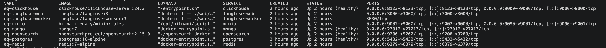 | 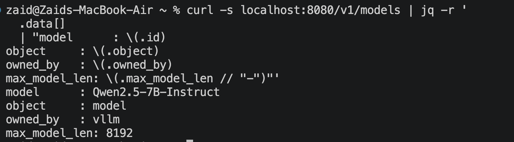 | 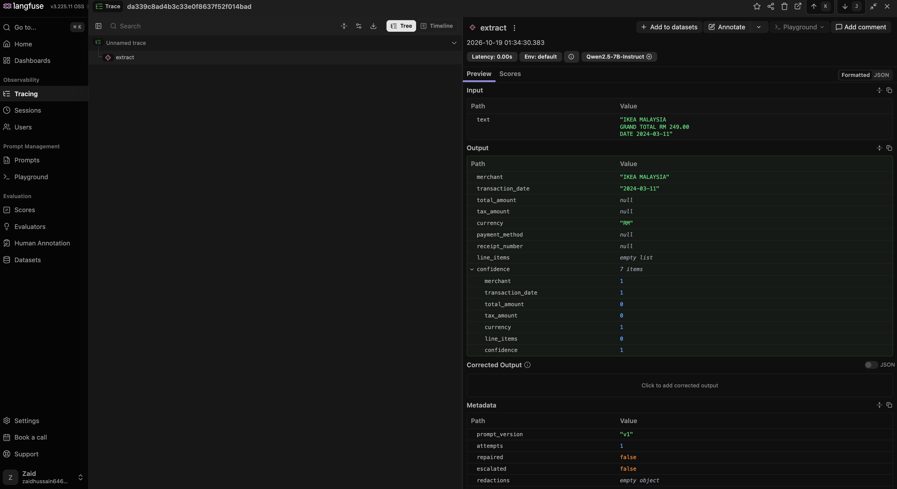 |
| **Quality (W&B)** | **PromptFoo** | **CI** |
| 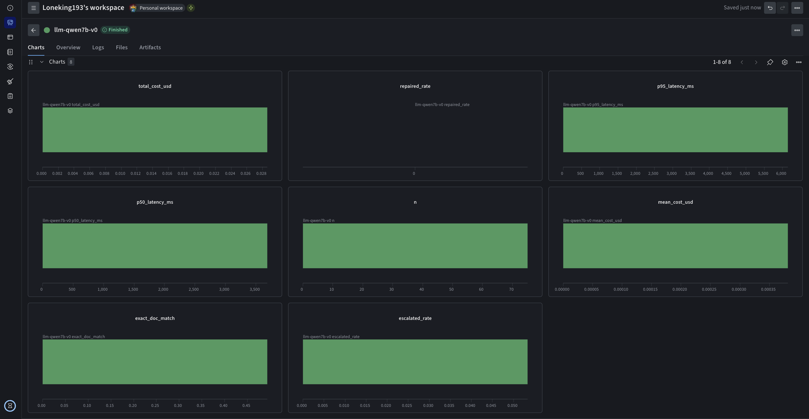 | 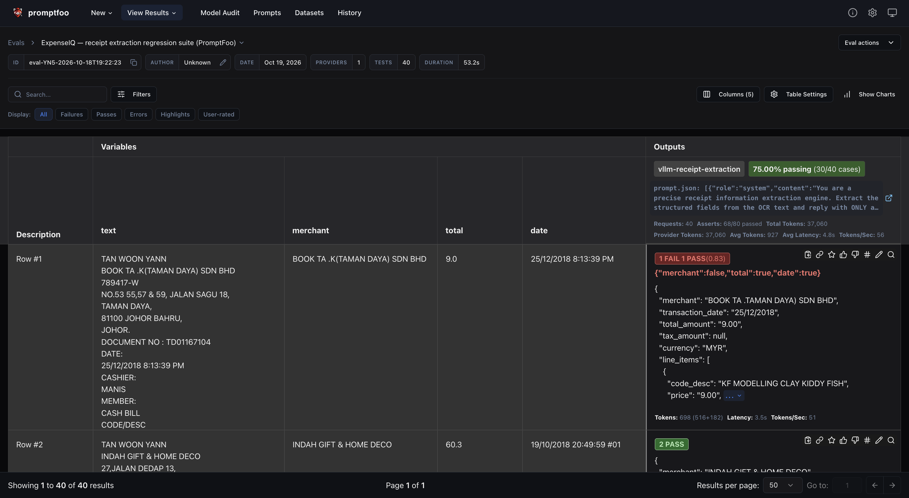 | 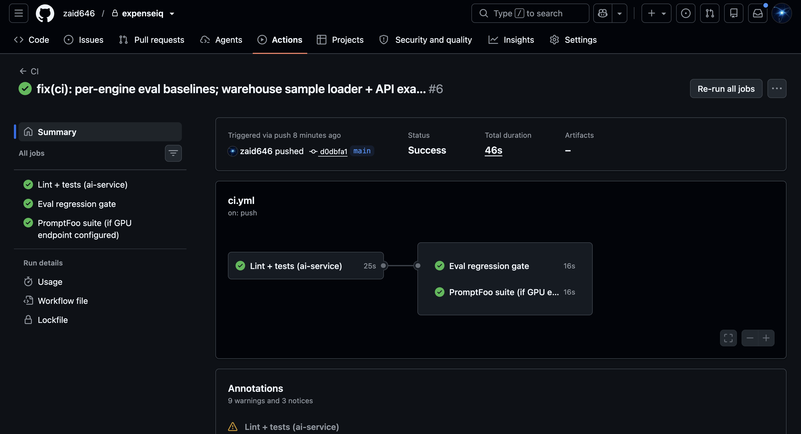 |
| **API smoke** | **Snowflake views** | **End-to-end submit** |
| 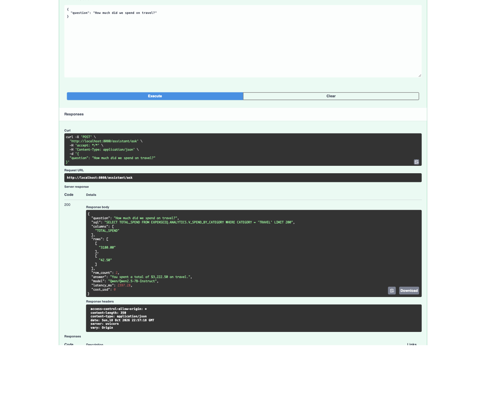 | 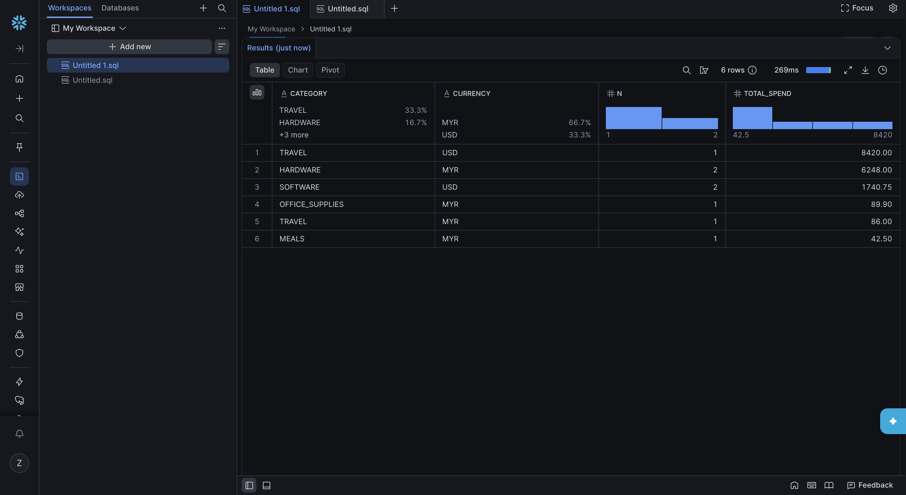 | 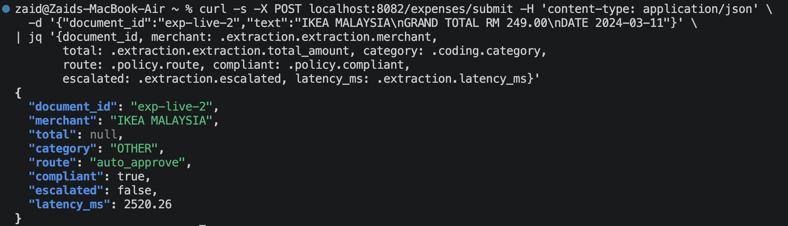 |
| **QLoRA fine-tune** | **QLoRA served** | **Coding compare** |
| 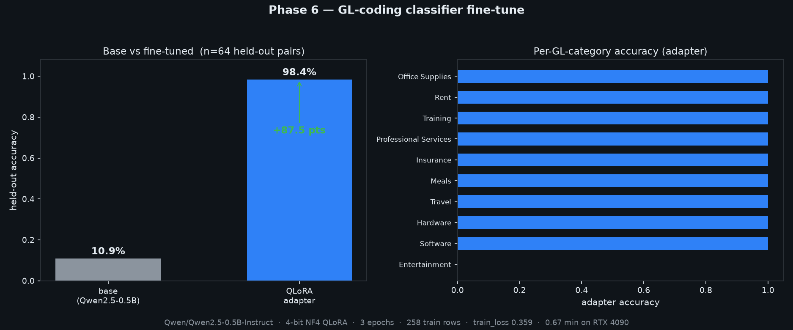 | 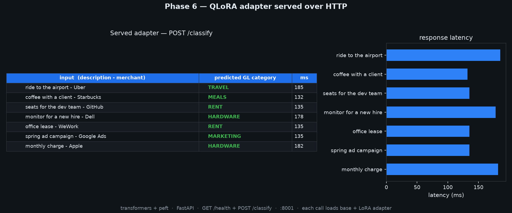 | 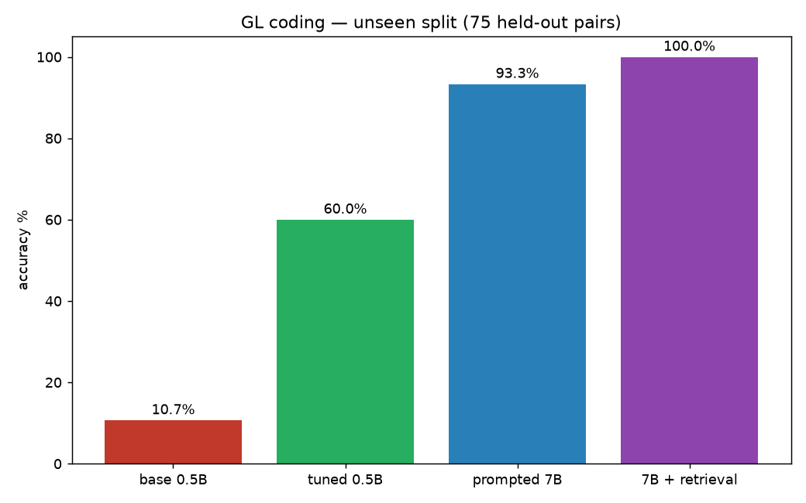 |

Notebooks: [`01_dataset_exploration`](evidence/png/04-notebook-dataset.png) ·
[`02_baseline_extraction`](evidence/png/05-notebook-baseline.png).

## Security practices

- PII and card numbers are redacted **before** every LLM call.
- Secrets live only in `.env` (gitignored); `.env.example` documents required keys.
- Self-hosted inference keeps document content off third-party model APIs.

## License

MIT — see [LICENSE](LICENSE).
